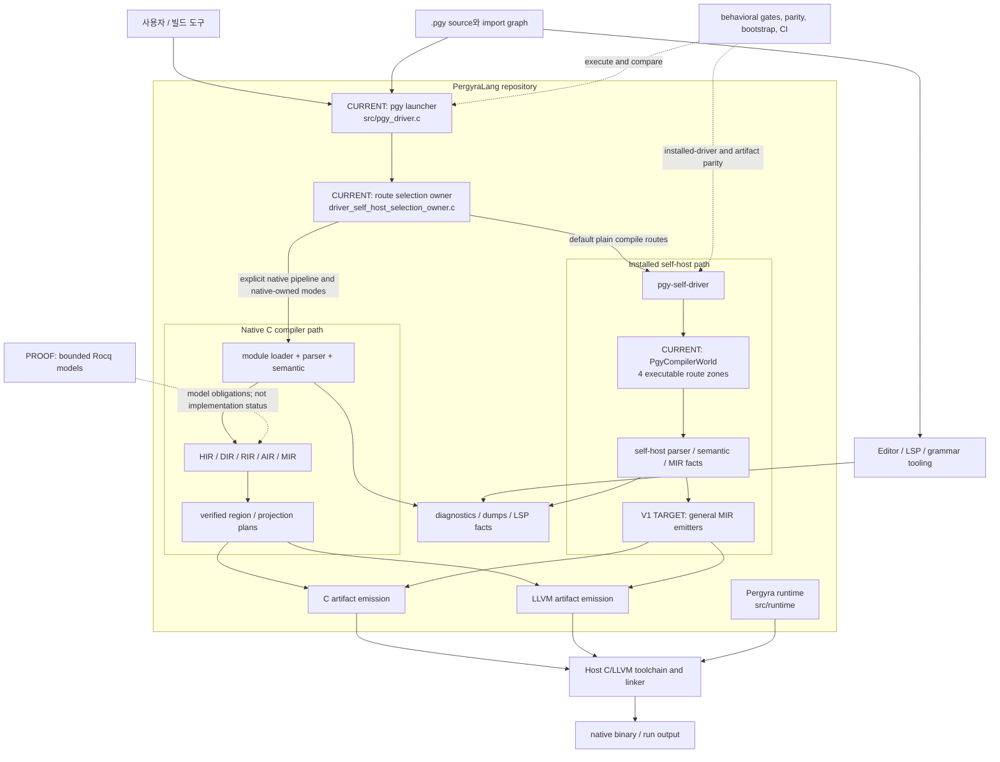
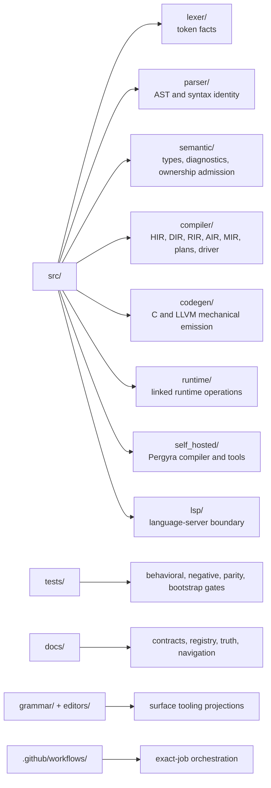

# 01. 시스템 문맥과 저장소 경계

이 그림은 Pergyra 소스가 사용자 요청에서 실행 artifact가 되기까지의 큰
경계를 보여 준다. 세부 의미와 최신 상태는 각 링크의 owner가 소유한다.

## 전체 구성 요소

## 저장소 디렉터리 책임

디렉터리가 owner를 자동으로 결정하지는 않는다. 예를 들어 backend 파일이
타입·소유권·ABI 결정을 다시 만들면, 디렉터리가 맞더라도 SoT는 중복된다.

## 경계를 바꿀 때

- launcher 경로를 바꾸면 self-host 선택 owner와 installed-driver gate를 함께
  확인한다.
- IR/ABI 사실을 바꾸면 C와 LLVM을 각각 고치는 것이 아니라 그 사실 owner와
  두 backend 소비를 함께 추적한다.
- runtime symbol을 추가하면 compiler-side runtime-call ABI와 실제 runtime 구현,
  link 경계를 한 사슬로 본다.
- LSP나 dump 출력이 production compilation과 같은 사실을 필요로 하면 semantic
  owner를 재사용한다. 출력 경로가 별도 의미 owner가 되면 안 된다.

## 권위 링크

- 네이티브 실행 흐름: [02_native_compiler_pipeline.md](02_native_compiler_pipeline.md)
- self-host world: [03_self_host_world.md](03_self_host_world.md)
- 현재/목표 논리 계층: [180번 문서](../180_compiler_logical_spine_handles_gates.md)
- 최신 상태: [truth/state](../truth/state/)

