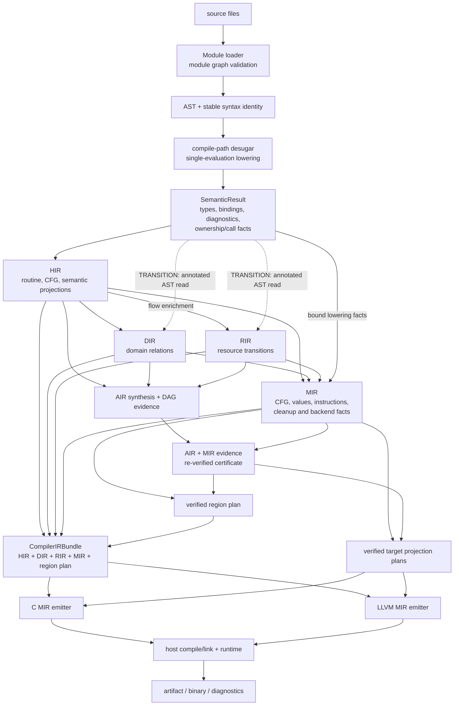
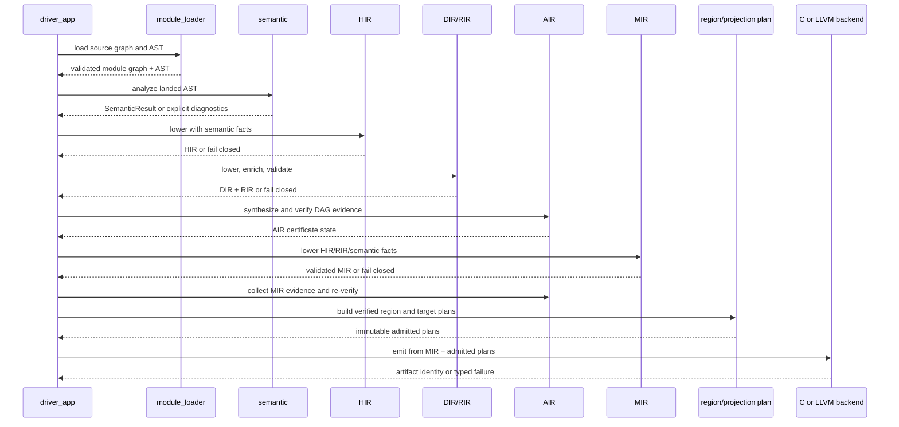

# 02. 네이티브 컴파일 파이프라인

이 도표는 `src/compiler/driver_app.c`의 production 호출 순서와 현재 사실 전달을
요약한다. 목표 IR 계층만을 그린 그림이 아니다. `TRANSITION` 화살표는 현재
소스에 남아 있지만 장기 owner 구조에서는 제거해야 하는 직접 읽기다.

## 현재 실행 및 사실 흐름

## 호출 순서

## 현재 구조와 목표 구조를 구분하는 지점

| 경계 | 현재 읽기 | 목표 불변식 |
|---|---|---|
| parser → semantic | AST와 module graph | identity가 import merge 뒤에도 안정적이어야 한다 |
| semantic → HIR | semantic facts와 annotated AST | 후속 계층이 필요한 typed fact를 HIR/typed owner가 보존한다 |
| HIR → DIR/RIR | HIR fact와 일부 AST 직접 입력 | DIR/RIR가 AST를 다시 훑어 의미를 복원하지 않는다 |
| MIR → backend | MIR + AIR-admitted plan | backend가 AST/HIR/source spelling으로 타입·소유권·ABI를 재추론하지 않는다 |
| backend → artifact | verified plan identity와 emitted artifact | C/LLVM 표현은 달라도 같은 owner facts를 소비한다 |

## 변경 영향 지도

- **새 surface syntax:** lexer → AST → parser → semantic → 필요한 IR → C/LLVM →
  runtime/parity 순으로 확인한다.
- **새 MIR instruction:** MIR schema/validator → 일반 C emitter → 일반 LLVM emitter →
  runtime-call ABI → parity/negative gate 순으로 확인한다.
- **새 ABI row:** ABI owner에서 발급하고 projection plan으로 운반한다. backend별
  local spelling 결정으로 시작하지 않는다.
- **새 ownership fact:** semantic producer → HIR carrier → MIR cleanup consumer →
  두 backend의 물리 release까지 이어져야 한다. 자세한 지도는
  [04_ownership_automation.md](04_ownership_automation.md)에 있다.

## 권위 링크

- 현재 구현 안내: [20번 문서](../20_compiler_pipeline_guide.md)
- 계층별 계약: [36번 문서](../36_ir_pipeline_architecture.md)
- logical spine: [180번 문서](../180_compiler_logical_spine_handles_gates.md)
- production entrypoint: [`driver_app.c`](../../src/compiler/driver_app.c)

