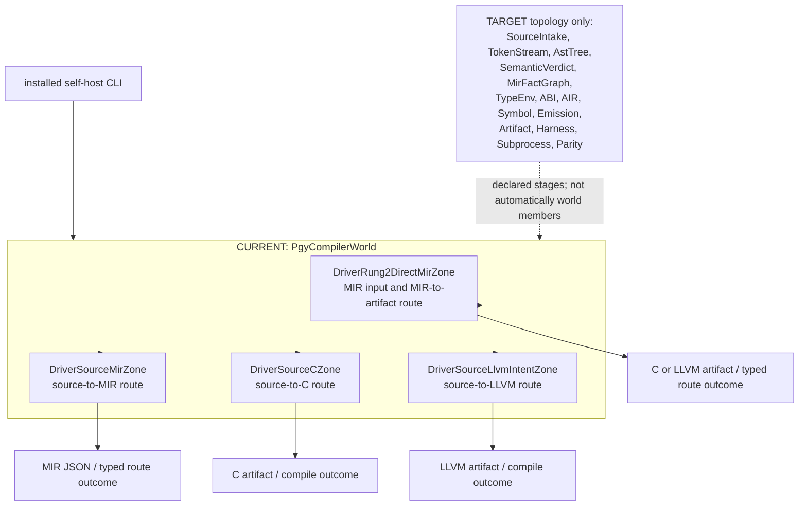
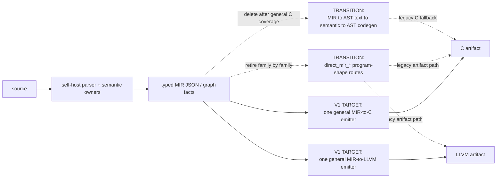
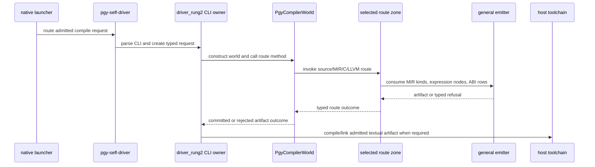

# 03. Self-host world와 V1 교체 경로

`world.pgy`에는 많은 stage zone이 선언돼 있지만 현재
`PgyCompilerWorld`의 실제 멤버는 네 route zone이다. 선언된 target topology와
production-reachable world membership을 같은 것으로 세지 않는다.

## 현재 world membership

`PgyCompilerWorld`의 public methods는 네 route를 조합한다.

| World method | 실행 zone / intent |
|---|---|
| `EmitDirectMir`, `ProduceMirC`, `PublishMirCArtifact` | `direct_mir` |
| `ProduceSourceMir`, `PublishSourceMirArtifact` | `source_mir` |
| `ProduceSourceC`, `CompileSourceToC` | `source_c`, `CompilePergyraCArtifact` |
| `CompileSourceToLlvm` | `source_llvm`, `source_mir`, `direct_mir`, `CompilePergyraProgram` |

## V1의 일반화 사슬

일반 emitter는 프로그램 이름, routine 수, 타입 조합 또는 fixture shape를
admission 조건으로 사용하지 않는다. 분기는 다음 세 축에 의해 결정된다.

1. MIR instruction kind;
2. expression node kind;
3. ABI/layout row.

지원하지 않는 입력은 typed route refusal로 실패한다. 누락된 kind나 row를 특정
프로그램 shape owner로 우회해 통과시키면 일반화가 아니다.

## installed-driver sequence

## 수정 시 확인할 경계

- `world.pgy`에 zone을 선언한 것과 `PgyCompilerWorld` 멤버로 연결한 것은 별개다.
- route action은 기존 parser/MIR/ABI/target fact의 마지막 orchestration consumer다.
  그 사실을 새로 추론하는 owner가 아니다.
- 일반 emitter가 한 family를 대체하면 실제 caller를 이관하고 해당 shape route를
  삭제한다. 두 경로를 정상 fallback으로 남기지 않는다.
- source-to-C, source-to-LLVM, direct-MIR 경로는 같은 의미 fact를 소비하지만
  artifact commit과 host toolchain 경계는 각 route의 typed outcome을 유지한다.
- V1 완료는 같은 published commit의 bootstrap, `gen2 == gen3`, installed-driver
  C/LLVM parity와 필수 CI가 필요하다. 최신 결과는 UML이 아니라
  [truth/state](../truth/state/)에서 확인한다.

## 권위 링크

- 실제 world: [`world.pgy`](../../src/self_hosted/compiler/world.pgy)
- self-host substrate: [13번 문서](../self_hosted/13_compiler_substrate_architecture.md)
- target world: [14번 문서](../self_hosted/14_target_compiler_world.md)
- reachability 판정: [17번 dogfood contract](../self_hosted/17_pergyra_native_dogfood_contract.md)
- V1 종료선: [V1 scope](../agent_work_directives/v1_scope_ownership_and_selfhost_generality_2026-10-14.md)

