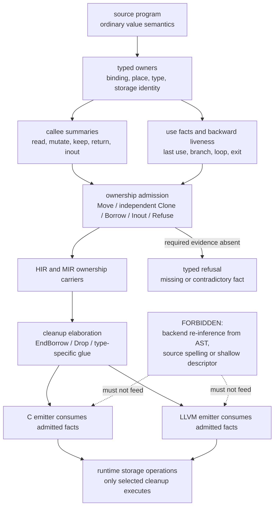
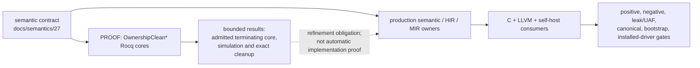
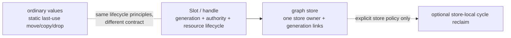

# 04. 소유권 기반 자동 메모리 관리

Pergyra의 기본 방향은 tracing GC가 아니라 **소유권 기반 자동 메모리 관리**다.
사용자는 수동 deep-drop 절차를 쓰지 않고, 컴파일러가 typed evidence로
move/copy/borrow/cleanup을 결정한다. 이 UML은 production 연결 경계를 보여 주며,
Rocq의 bounded theorem을 전체 언어 구현 완료로 확대하지 않는다.

## 사실 생산부터 물리 cleanup까지

### 결정의 핵심

| 상황 | 컴파일러 결정 | 금지되는 대체 |
|---|---|---|
| 소유 값의 마지막 사용 | storage 책임을 move | 원본과 결과를 둘 다 owner로 남김 |
| 이동 뒤 호출자가 다시 사용 | 허용된 타입이면 독립 전체 `Clone` | shallow descriptor copy |
| readonly borrow | 원래 owner를 유지하고 borrow만 끝냄 | borrowed storage release |
| `inout` | 호출 동안 책임을 넘기고 갱신된 owner를 돌려받음 | field carrier 의식을 사용자 기본 해법으로 강요 |
| 죽은 owned binding | 타입별 drop glue로 정확히 한 번 정리 | backend별 별도 cleanup 추론 |
| 필수 요약·identity 누락 | 해당 경계에서 fail closed | borrowed/owned 추측 fallback |

## 값 생애 상태도

```mermaid
stateDiagram-v2
    [*] --> Owned: create / receive owner
    Owned --> Borrowed: begin read or write borrow
    Borrowed --> Owned: end borrow
    Owned --> Moved: last-use transfer
    Moved --> OwnedByNext: callee, result, aggregate owns storage
    state clone_fork <<fork>>
    Owned --> clone_fork: later use requires allowed independent copy
    clone_fork --> Owned: original remains owner
    clone_fork --> CloneOwned: new storage has a distinct owner
    Owned --> Retired: certified last use / owner scope end
    OwnedByNext --> Retired: next owner's certified end
    CloneOwned --> Retired: clone owner's certified end
    Moved --> Refused: old binding used without admitted copy
    Borrowed --> Refused: grow, move, or release conflicts with live view
    Refused --> [*]: diagnostic; no guessed ownership
    Retired --> [*]
```

`Moved`는 storage가 사라졌다는 뜻이 아니라 정리 책임이 다음 owner로 이동했다는
뜻이다. `CloneOwned`는 같은 backing의 두 번째 descriptor가 아니라 독립 저장소다.

## 증명과 production 연결

Rocq 모델이 닫혀 있어도 다음은 별도 production 의무다.

- 실제 모든 place/storage identity를 빠짐없이 발급하고 운반하는가;
- 호출 사슬의 요약 고정점과 분기·loop·exit가 실제 프로그램을 sound하게
  admit하는가;
- 타입별 Clone과 drop glue가 allocator provenance와 active payload를 보존하는가;
- C, LLVM, self-host가 같은 cleanup fact를 소비하는가;
- 안전 규칙을 약화하지 않고 fixed canonical/DRV-2 경계가 통과하는가.

## 일반 값, Slot, graph store의 경계

일반 값을 전부 Slot에 넣거나 graph store를 기본 GC로 쓰지 않는다. graph의 link는
대상을 식별하지만 정리권을 소유하지 않으며, 선택적 순환 회수는 store 내부의
별도 정책이다.

## 권위 링크

- 언어 정책: [Ownership Clean](../semantics/27_ownership_clean.md)
- 전체 알고리즘 설명: [207번 문서](../207_compiler_owned_cleanup_algorithm.md)
- lifecycle/graph 설명: [209번 문서](../209_ownership_lifecycle_algorithm_code.md)
- 메모리 경계 합성: [28번 문서](../semantics/28_memory_boundary_composition.md)
- 실제 완료 상태: [truth/state](../truth/state/)

