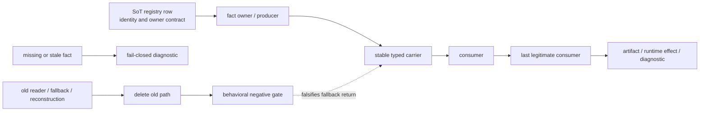
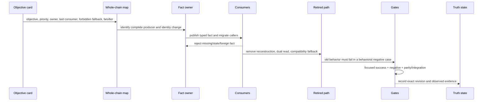
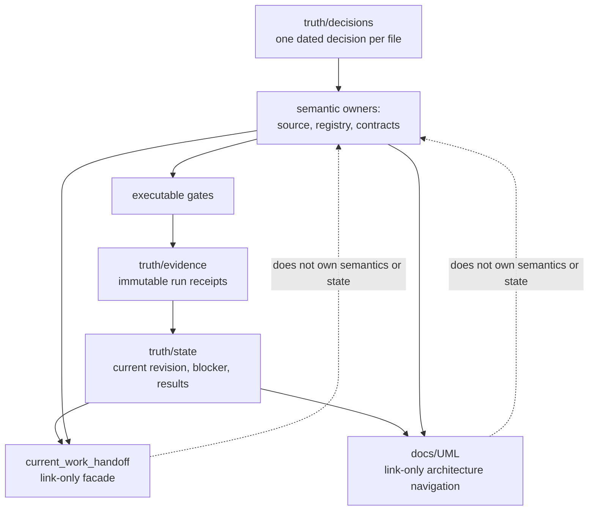
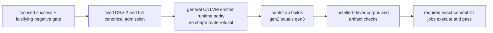

# 05. SoT와 검증 폐쇄

SoT 폐쇄는 문서나 owner 파일이 생겼다는 뜻이 아니다. 한 사실이 한 owner에서
발급되고, 모든 실제 consumer가 그 사실을 사용하며, 옛 경로가 삭제되고,
missing fact와 옛 우회가 행동 gate에서 거부될 때 닫힌다.

## 한 사실의 생애

`CLOSED`를 말하려면 아래 네 가지가 모두 필요하다.

1. consumer migration;
2. missing-fact failure;
3. old-path deletion;
4. behavioral negative gate.

파일명, 심볼 문자열, 문구의 부재를 세는 text scan은 네 번째 조건을 대신하지
않는다.

## 구조 변경 절차

새 consumer나 ownership dependency가 나타나면 patch를 조용히 늘리지 않고
whole-chain map과 남은 change set을 다시 고친다.

## 문서와 실행 증거의 관계

## V1 검증 계단

작은 slice에서는 가장 좁은 gate부터 실행한다. 그러나 V1 완료는 위 항목들이
같은 published commit에서 함께 성립해야 한다. skipped job, 축소한 입력,
안전 규칙 완화는 green으로 세지 않는다.

## 변경 유형별 마지막 소비자

| 사실 계열 | 대표 owner | 마지막 소비자 / 폐쇄 경계 |
|---|---|---|
| source/syntax identity | module loader, parser/AST owner | diagnostics, HIR lowering, source map |
| binding/type/call facts | semantic/type DAG owner | HIR/DIR/RIR/MIR와 AIR evidence |
| resource/authority transitions | RIR owner | MIR와 AIR verifier |
| executable value/cleanup facts | MIR owner | projection planner와 C/LLVM/self-host emitter |
| ABI/runtime-call facts | ABI/target owner | verified projection plan을 통한 emitters |
| self-host orchestration | `PgyCompilerWorld` route owner | artifact commit/parity boundary |
| 현재 상태 | `docs/truth/state`의 lane-owned file | handoff와 사람의 다음 작업 선택 |

표는 owner identity를 찾기 위한 입구다. 정확한 row와 현재 상태는
[SoT registry](../semantics/sot_owner_spine_registry.md)와 실제 source에서 확인한다.

## 권위 링크

- owner registry: [SoT Owner Spine Registry](../semantics/sot_owner_spine_registry.md)
- migration protocol: [180번 문서](../compiler/180_compiler_logical_spine_handles_gates.md)
- truth layout: [Project truth](../truth/README.md)
- V1 finish line: [V1 scope](../agent_work_directives/v1_scope_ownership_and_selfhost_generality_2026-10-14.md)
- active facade: [current work handoff](../current_work_handoff.md)

